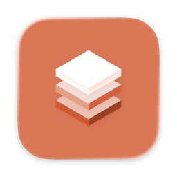
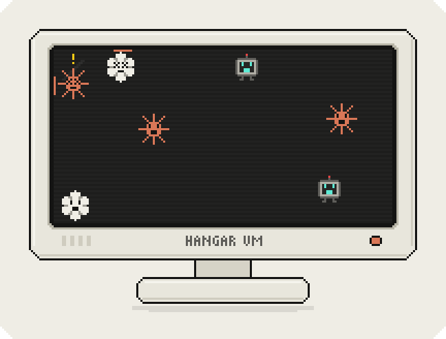
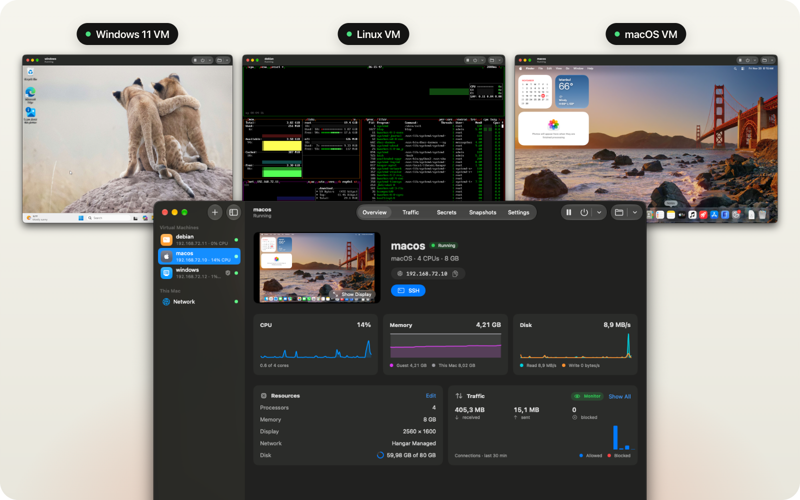
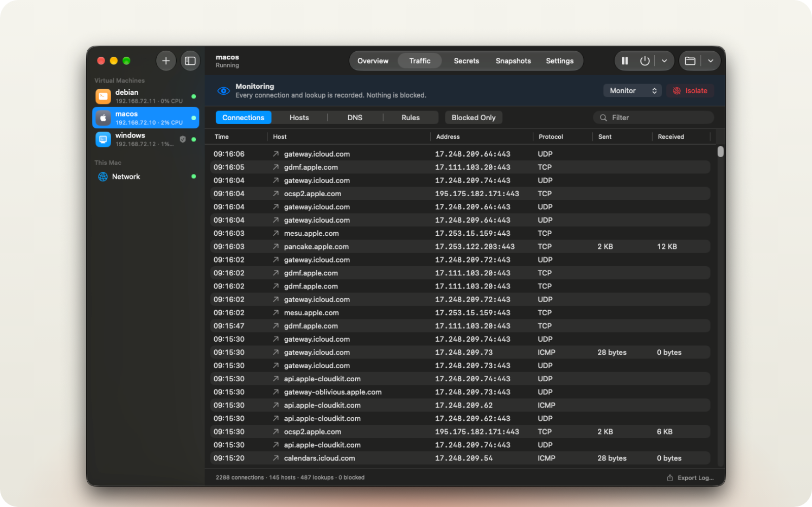
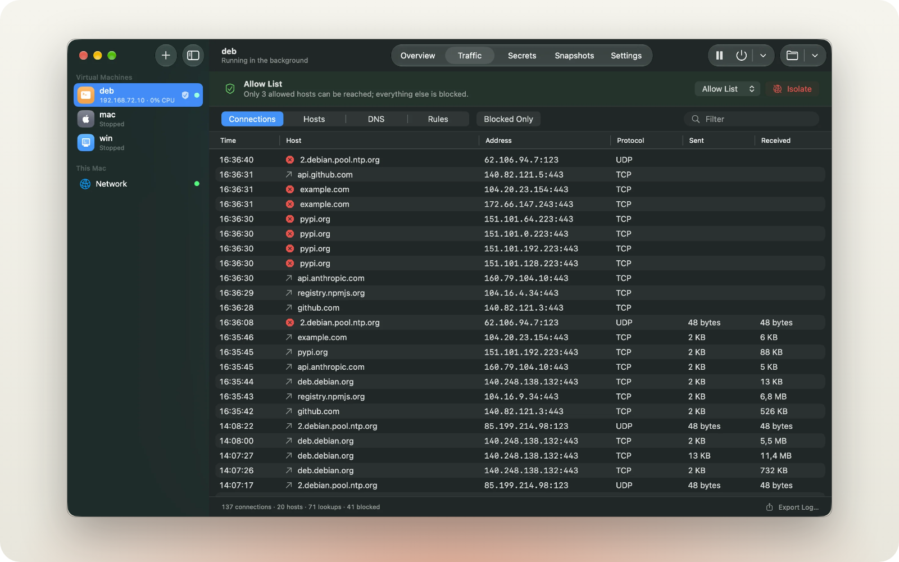
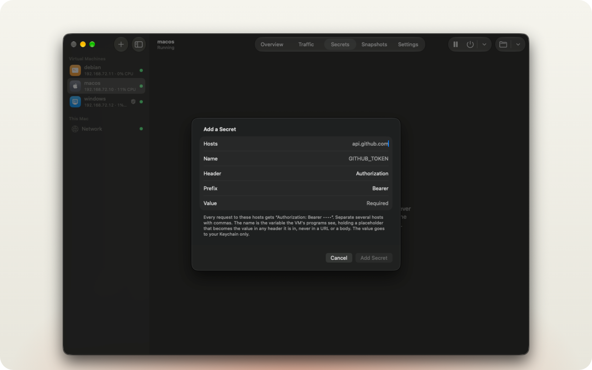
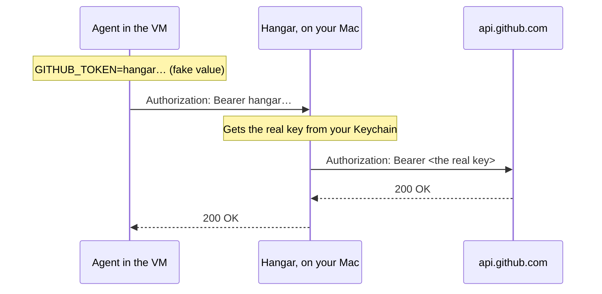
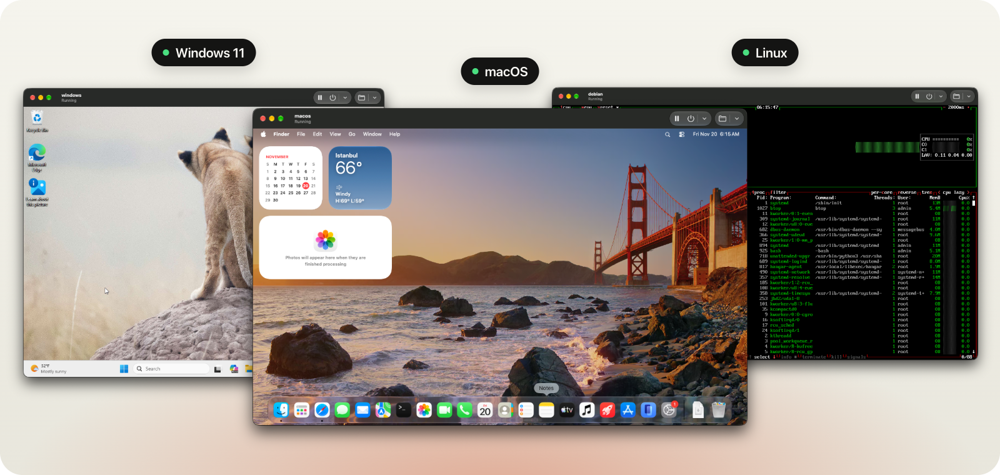
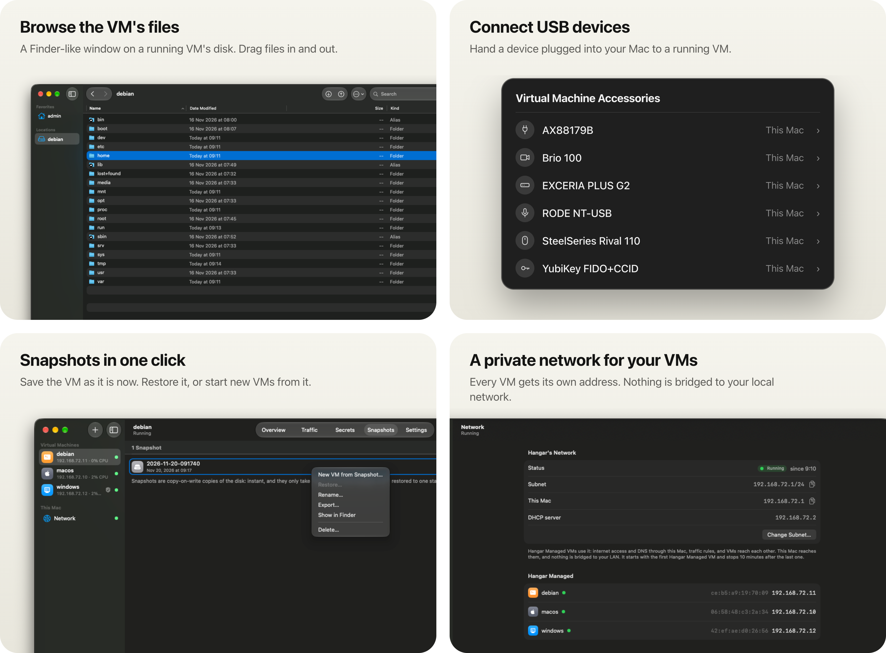
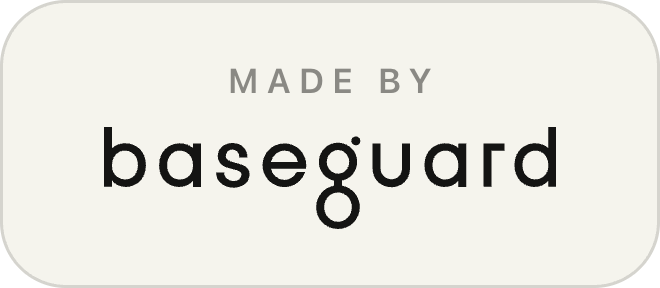

<p align="center">
  
</p>

<h1 align="center">Hangar</h1>

<p align="center">
  <b>Run AI coding agents in a macOS, Linux or Windows virtual machine on your Mac.</b>
</p>

<p align="center">
  <a href="https://hangar.bot/download"><b>Download for Mac</b></a> ·
  <a href="https://hangar.bot/docs/getting-started">Quick start</a> ·
  <a href="https://hangar.bot/docs">Docs</a>
</p>

<p align="center">
  <a href="https://github.com/baseguard/hangar/releases/latest"></a>
  
  
  <a href="LICENSE"></a>
</p>

<p align="center">
  
</p>

Claude Code, Codex and other coding agents work fastest when you turn off approvals, so they don't stop to ask
before every command. But then they can do anything on your computer. Hangar runs the agent in its own virtual
machine instead:

- **It can't see the files on your Mac.** Only the one folder you share with it.
- **It can only connect to the websites you allow.** Everything else is blocked, and you see every connection it
  makes.
- **It can use your API keys, but the keys are never inside the VM.**
- **If it breaks something, you undo it.** One command puts the VM back the way it was.

The VM can be macOS, Linux or Windows. Hangar is a Mac app and a command line (`hangar`) that work on the same VMs.

<p align="center">
  
</p>

## Without Hangar, with Hangar

|  | Agent on your Mac, approvals off | Agent in a Hangar VM, approvals off |
|---|---|---|
| **Your files** | It can read and change all of them | It sees only the folder you share |
| **Your SSH keys, cloud keys, browser** | Within reach | Not in the VM |
| **Internet** | It can connect anywhere | Only the sites you allow |
| **Your API tokens** | Sitting in files and environment variables | Added outside the VM, only for the sites you choose |
| **If it deletes or breaks something** | It's gone | Restore the snapshot |

## Install

Download the app from [Releases](https://github.com/baseguard/hangar/releases/latest), or install it with Homebrew:

```sh
brew install --cask baseguard/tap/hangar
```

To use the `hangar` command, open Hangar and choose **Settings › Command Line › Install…**.

## Quick start: Claude Code in a VM

```sh
# 1. Create a Debian VM and start it in the background
hangar create kestrel --os linux --image debian
hangar run kestrel --background

# 2. Open a shell in the VM and install Claude Code
hangar exec -it kestrel bash
#   curl -fsSL https://claude.ai/install.sh | bash

# 3. Allow only Anthropic and GitHub. Everything else is blocked.
hangar policy kestrel --mode allowlist --allow anthropic.com --allow claude.ai --allow github.com

# 4. Save the VM's current state, so you can go back to it later
hangar snapshot take kestrel clean

# 5. In the VM, run: claude --dangerously-skip-permissions
#    On your Mac, watch every connection it makes:
hangar traffic kestrel --follow

# 6. Something went wrong? Put the VM back the way it was:
hangar stop kestrel
hangar snapshot restore kestrel clean
```

Prefer the app? Press <kbd>⌘N</kbd>, pick **macOS** or **Linux**, and click **Create and Start**.

> [!TIP]
> The full guide, with a checklist for agents you don't trust, is in
> [Running AI agents](https://hangar.bot/docs/ai-agents).

## Features

### See every connection the VM makes

Hangar records every website the VM looks up and connects to, how much data went each way, and what was blocked.
It does this from your Mac, outside the VM, so nothing running inside the VM can hide its connections or turn the
recording off.

<p align="center">
  
</p>

The same list in the terminal:

```text
$ hangar traffic kestrel --follow
02:39:41  allow  tcp     github.com           140.82.121.3:443     ↑2 KB ↓570 KB
02:39:42  BLOCK  dns     example.com A                             example.com is not allowed
02:39:43  BLOCK  udp     1.1.1.1              1.1.1.1:443          QUIC is blocked
```

### Allow only the websites you choose

Turn on an allow list, and the VM can reach only those sites. Changes apply immediately, even while the agent is
working. Blocked connections are marked in red.

<p align="center">
  
</p>

To cut the VM off from the internet at once:

```sh
hangar policy kestrel --isolate on
```

### Use API keys without putting them in the VM

Store a key in Hangar and it stays in your Mac's Keychain. Inside the VM, the environment variable holds a fake
value. When the VM sends a request to a site you chose, Hangar replaces the fake value with the real key on the way
out.

<p align="center">
  
</p>

Or from the command line:

```sh
gh auth token | hangar secret set kestrel GITHUB_TOKEN --host api.github.com --value-stdin
```



If the fake value is sent to any other site, it stays fake. [How secrets work](https://hangar.bot/docs/secrets)

### Undo everything with snapshots

A snapshot saves the VM's disk as it is right now. Taking one is instant. Restoring it throws away every change made
since.

```sh
hangar snapshot take kestrel clean
hangar snapshot restore kestrel clean
```

### Run several agents at once

Make copies of a VM from a snapshot. Each copy is a separate VM with its own network address.

```sh
hangar clone kestrel kestrel-2 --snapshot clean
hangar clone kestrel kestrel-3 --snapshot clean
```

### Let Claude Code or Codex create VMs for you

`hangar mcp` is an MCP server. Add it to Claude Code or Codex on your Mac:

```sh
claude mcp add hangar -- hangar mcp
codex mcp add hangar -- hangar mcp
```

Then ask: *"Create a Debian VM with Go installed that can only connect to github.com."* The agent can create and
start VMs, run commands in them, copy files, take snapshots and change which sites a VM can reach. It can't delete
VMs, and it never sees your keys or passwords.

### macOS, Linux and Windows

<p align="center">
  
</p>

| VM | How to get it |
|---|---|
| **macOS** | Ready-made images (plain, with Homebrew, or with Xcode), or any macOS version from Apple |
| **Linux** | Ready-made Debian and Ubuntu images, any installer ISO, or your own image |
| **Windows 11** | Microsoft's ISO for Arm. Hangar installs it without you clicking through the setup |

### Other features

| Command | What it does |
|---|---|
| `hangar exec kestrel uname -a` | Run a command in the VM, without SSH |
| `hangar cp report.pdf kestrel:/home/admin/` | Copy files into or out of the VM |
| `hangar share add kestrel ~/Code/app --read-only` | Share one folder from your Mac with the VM |
| `hangar export kestrel ghcr.io/acme/dev:1.0` | Upload a VM to a container registry, so your team can download the same VM |
| `hangar template save kestrel dev.hangarvm` | Save a VM's settings to a file, to create the same VM again |

In the app:

<p align="center">
  
</p>

The clipboard can be shared with the VM too. It's off by default.

## Comparison with similar tools

|  | Hangar | Tart | Docker Sandboxes | NVIDIA OpenShell |
|---|---|---|---|---|
| **Runs the agent in** | A full VM | A full VM | A small VM (microVM) | A restricted process (Landlock, seccomp) |
| **Operating systems** | macOS, Linux, Windows 11 | macOS, Linux | Linux | Linux |
| **Mac app** | Yes, and a command line | Command line only | Command line only | Command line only |
| **Allow only some websites** | Yes, changes apply immediately | By IP range only, set when the VM starts | Yes, changes apply immediately | Yes, changes apply immediately |
| **Log of every connection** | Yes, recorded outside the VM | No | Allowed and blocked sites | Connections and HTTP requests |
| **API keys added outside the VM** | Yes | No | Yes | Yes |

Checked in November 2026. Sources for every row: [hangar.bot/compare](https://hangar.bot/compare).

## Questions

<details>
<summary><b>What doesn't Hangar protect against?</b></summary>

<br>

- **A new VM blocks nothing.** It only records connections until you turn on an allow list.
- **Use an allow list, not a block list.** A block list only stops connections that use a blocked site's name.
- **For HTTPS, Hangar sees the site's name, not the full URL.** A site that shares an IP address with an allowed
  site (for example, behind the same CDN) may be reachable.
- **Keys are only added to request headers.** A site that sends your request back to you, or returns the key in
  another form, shows the key to the VM. Only give keys to sites you trust, with only the permissions the VM needs.
- **A shared folder the VM can write to can affect your Mac.** For example, a Git hook the agent writes runs when you
  open the project on your Mac. Share it with `--read-only`, or clone the repository inside the VM.

The full list: [Limits](https://hangar.bot/docs/traffic-rules#limits).

</details>

<details>
<summary><b>Why a VM and not a Docker container?</b></summary>

<br>

A VM has its own operating system, disk and network. The agent can use root, `sudo`, Homebrew and run servers, and
the VM can be macOS or Windows, not only Linux.

</details>

<details>
<summary><b>Does Hangar connect to the internet by itself?</b></summary>

<br>

Only to check GitHub (api.github.com) for a new version, 20 seconds after it opens and then every 12 hours. It
downloads an update only when you ask. Turn the check off in **Settings › General › Updates**.

</details>

<details>
<summary><b>Where are the VMs stored, and how do I uninstall Hangar?</b></summary>

<br>

In `~/.hangar`. Set `HANGAR_HOME` to store them somewhere else. To uninstall, shut down the VMs, then delete the app,
`/usr/local/bin/hangar` and `~/.hangar`.

</details>

## Docs

[Getting started](https://hangar.bot/docs/getting-started) ·
[Running AI agents](https://hangar.bot/docs/ai-agents) ·
[Creating VMs](https://hangar.bot/docs/creating-vms) ·
[Traffic rules](https://hangar.bot/docs/traffic-rules) ·
[Secrets](https://hangar.bot/docs/secrets) ·
[Snapshots](https://hangar.bot/docs/snapshots) ·
[Commands](https://hangar.bot/docs/commands) ·
[Building from source](https://hangar.bot/docs/building)

## License

Hangar is free and open source under the [Apache License 2.0](LICENSE).

## Credits

- [Mustafa Akın](https://mustafaakin.dev/blog/windows-on-tart/), for showing that Windows runs on Apple's
  Virtualization framework.

<p align="center">
  <a href="https://baseguard.net"></a>
</p>
